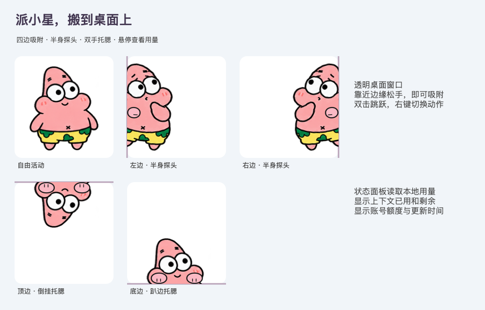

# 派小星

一只用 Swift / AppKit 编写的 macOS 桌面宠物。可以拖来拖去、贴在屏幕边缘探头，还能悬停查看本地 Codex 的上下文与额度快照。



## 功能

- 拖到屏幕边缘松手，自动吸附；左右半身探头，顶部倒挂托腮，底部趴边托腮。
- 多种表情和轻量动画；双击跳跃，右键调整大小、动作和会话。
- 悬停显示上下文已用 / 上限 / 剩余 token，以及短期和每周额度。
- 可选随 Codex 启动；支持多显示器，窗口位置和偏好自动保存。

## 使用

1. [下载桌面版（Apple Silicon）](downloads/PaiXiaoXing-macOS-arm64-v1.0.1.zip?raw=true)，解压后打开 `派小星.app`。
2. 拖动摆放，靠近边缘约 36 点以内松手即可吸附。
3. 鼠标停留约半秒查看用量；右键或菜单栏星星可以设置、隐藏和退出。

随 Codex 自动启动是可选功能。在解压目录运行：

```sh
bash 启用Codex联动.sh
# 关闭联动
bash 关闭Codex联动.sh
```

启用后，程序安装到 `~/Library/Application Support/PaiXiaoXing/`，监听器在登录后等待 Codex 启动。已运行时不会重复启动，手动退出桌宠后不会反复重开。

## 从源码构建

需要 macOS 13+ 和 Xcode Command Line Tools；使用与 Swift 编译器匹配的 macOS SDK。

```sh
bash 构建.sh
./派小星.app/Contents/MacOS/PaiXiaoXing --self-test
./派小星.app/Contents/MacOS/PaiXiaoXing --render-tests
./联动组件/CodexAutoStart --self-test
```

构建脚本支持通过 `PET_SDK` 指定 SDK。预编译包为 Apple Silicon 版，使用本地签名，未经 Apple 公证。

## 用量与隐私

程序不联网、不读取登录凭据，只提取本机 `~/.codex/sessions/`（或 `CODEX_HOME/sessions/`）的会话元数据和用量事件。

首次使用默认跟随最近活跃的主会话，也可右键锁定指定会话；这不等同于识别当前前台聊天页签。上下文采用最近一轮输入与输出 token 的快照，额度为账号共享的日志快照，均标明更新时间；无记录或已到重置时间时显示不可用或待更新。

角色素材根据参考图生成，相关角色权利归各自权利人所有。本项目与 OpenAI 无隶属关系。
